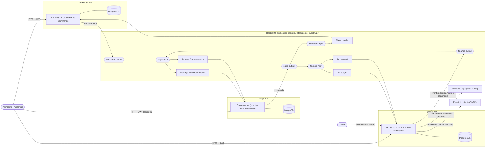
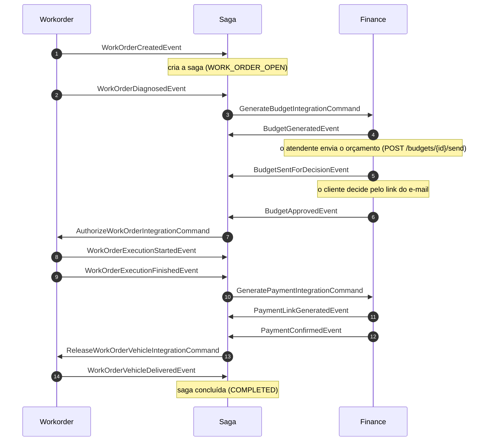
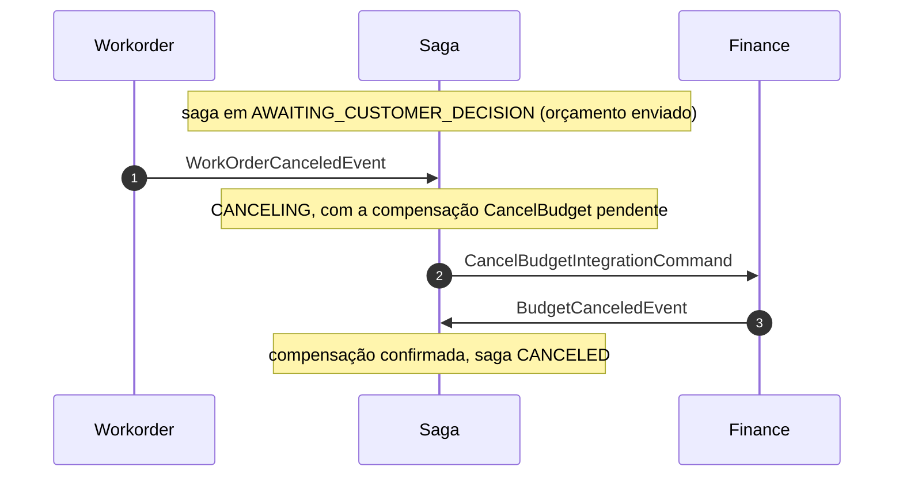
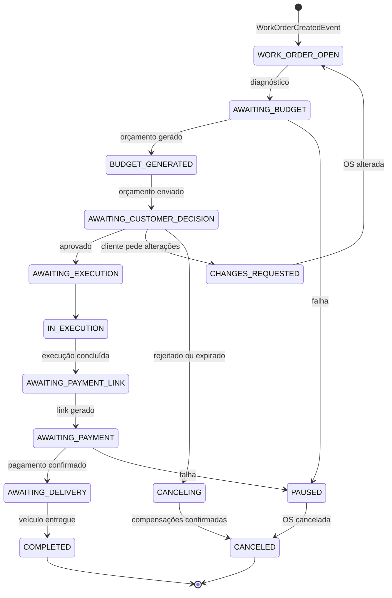
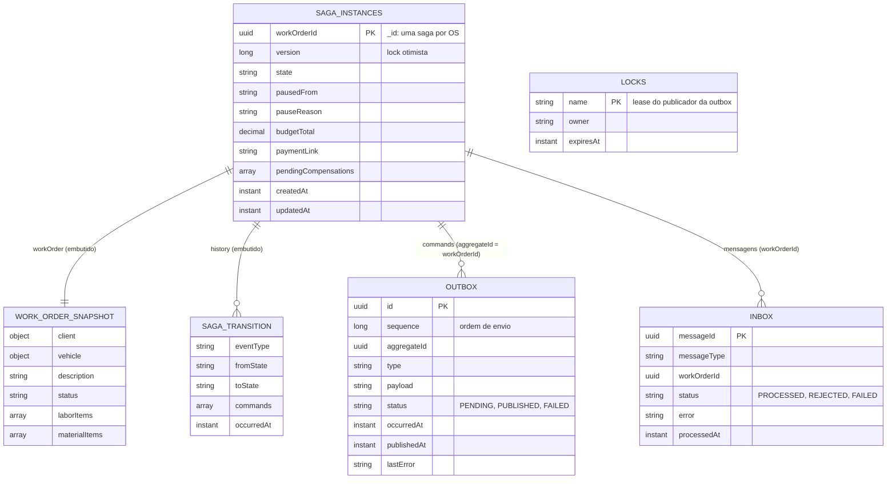

# Mecânica DM - Saga API (Orquestrador)

[](https://sonarcloud.io/project/overview?id=mecanica-dm_mecanicadm-saga-api-v4)


Orquestrador da **saga** do sistema **Mecânica DM**. Escuta os eventos da Workorder API e da Finance API e emite os _integration commands_ de cada passo, desfazendo o que já foi feito (compensação) quando algo falha. O fluxo, as transições e a topologia estão em [`docs/apoio/saga-fluxo.md`](docs/apoio/saga-fluxo.md).

Na **Fase 04** do 15SOAT, a aplicação foi refatorada para **microsserviços independentes** (Workorder, Finance e Saga), cada um com repositório, banco e pipeline próprios, que se integram por mensageria e mantêm a consistência das transações críticas com o **Saga Pattern**. Esta é a API que conduz esse fluxo.

---

## 📚 Documentação Externa e Modelagem

- **[Storytelling (Egon.io)](https://github.com/user-attachments/assets/fd2adfad-1fa9-469d-958a-1cf902666b36)**: Storytelling inicial do fluxo de funcionamento da mecânica.
- **[Dicionário de Dados (Notion)](https://lopsided-hourglass-4f8.notion.site/Dicion-rio-de-dados-32f0a8ca8e738075ae44c9ec0b5180b3?source=copy_link)**: Visão detalhada das entidades e relacionamentos do banco de dados (modelagem da Fase 03).
- **[Event Storming (Miro)](https://miro.com/app/board/uXjVIT7cD_4=/?share_link_id=217316260154)**: Mapeamento de domínio e comportamento orientado a eventos do sistema.
- **[Dashboard do SonarCloud](https://sonarcloud.io/project/overview?id=mecanica-dm_mecanicadm-saga-api-v4)**: Análise contínua de qualidade de código, vulnerabilidades e cobertura de testes.

### Arquitetura geral do sistema

Três microsserviços, cada um com o seu banco, falando só por mensageria. A saga hospeda o broker e conduz o fluxo.

<div align="center">



</div>

### Diagramas de sequência

#### Caminho feliz de uma OS



#### Cancelamento (compensação)

Cancelar a OS depois de enviar o orçamento: a saga desfaz o orçamento no Finance e só encerra quando recebe a confirmação.



### Estados da saga



O diagrama mostra os caminhos principais. A tabela completa de transições (evento, estado, command emitido e novo estado) está em [`docs/apoio/saga-fluxo.md`](docs/apoio/saga-fluxo.md).

### Dados guardados (MongoDB)



---

## ✨ Funcionalidades Principais

- **🎼 Orquestração por Eventos**: Uma saga por OS, conduzida por regras declaradas por etapa (evento, guarda e ação), sem uma sequência fixa.
- **↩️ Compensação com Confirmação**: Cada etapa declara o command que desfaz o seu efeito (orçamento, link de pagamento, estorno, cancelamento da OS), emitido da etapa mais avançada para a mais antiga e confirmado por evento.
- **⏸️ Pausa e Visibilidade**: O que a saga não resolve sozinha vai para `PAUSED`, com o motivo, e é sinalizado nos logs (`SAGA_PAUSED`, `SAGA_COMPENSATED`, `SAGA_COMPENSATION_FAILED`).
- **📬 Outbox e Inbox Transacionais**: Nenhum command se perde nem é executado duas vezes; falhas técnicas vão para a DLQ.
- **🔎 Consulta do Andamento**: API com listagem filtrada (OS, situação, etapa, pausa e datas) e consulta de uma saga com o histórico completo.
- **🔐 Autenticação Compartilhada**: Valida o mesmo JWT emitido pela Workorder.
- **📜 Contratos Testados**: O formato das mensagens é o que cada serviço consumidor lê, e há testes de contrato dos dois lados.

---

## 🚀 Tecnologias Utilizadas

| Categoria        | Tecnologia                                                  |
|------------------|-------------------------------------------------------------|
| **Core**         | Java 21, Spring Boot 3.4                                    |
| **Dados**        | Spring Data MongoDB (replica set), banco **NoSQL** próprio  |
| **Mensageria**   | RabbitMQ (Spring AMQP), exchanges `headers`                 |
| **Segurança**    | Spring Security, JWT (Java JWT)                             |
| **Documentação** | Springdoc (Swagger/OpenAPI 3)                               |
| **Testes**       | JUnit 5, Mockito, Testcontainers (MongoDB e RabbitMQ)       |
| **Qualidade**    | JaCoCo, SonarCloud                                          |
| **Build**        | Maven                                                       |
| **Container**    | Docker, Docker Compose                                      |

> ‼️ O banco utilizado foi o MongoDB, a justificativa formal se encontra na **RFC 002 - Escolha do MongoDB como banco da saga**, na seção RFCs.

---

## 🏛️ Arquitetura e Decisões

Arquitetura limpa: o `core` não depende de framework, e a `infra` é a borda técnica.

```
src/main/java/com/mecanicadm/saga_api
├── core/saga/
│   ├── engine/    motor genérico: regras, guardas, orquestrador e planejador de compensação
│   ├── flow/      SagaFlow, que monta o fluxo
│   │   └── steps/ o negócio: uma classe por etapa (registro, orçamento, decisão, execução, pagamento, entrega, cancelamento, recusa)
│   ├── domain/    SagaInstance (o agregado), SagaState, SagaStep e o retrato da OS
│   ├── event/     os eventos que a saga recebe (interface sealed)
│   ├── command/   os integration commands que a saga envia
│   └── usecase/   ProcessSagaEventUseCase, GetAllSagasUseCase e GetSagaByIdUseCase
├── infra/features/saga/    consumer das filas, API de consulta, persistência no MongoDB
├── infra/messaging/        inbox, outbox, lock do publicador e configuração do RabbitMQ
└── infra/security/         validação do JWT
```

O motor (`engine`) não tem regra de negócio: cada etapa em `flow/steps` declara as suas regras (evento, guarda e ação) e as suas compensações. Incluir um passo novo é criar o evento, declarar a regra na etapa certa e, se houver efeito a desfazer, uma compensação.

### Por que uma saga orquestrada

O desafio pede o Saga Pattern e que a escolha entre **orquestração** e **coreografia** seja justificada. Escolhemos a orquestração, em um serviço próprio, porque o fluxo de uma OS tem muitas saídas além do caminho feliz (o cliente pode rejeitar ou pedir alterações, a OS pode ser cancelada em qualquer fase, o pagamento pode chegar depois do cancelamento) e cada passo concluído precisa de uma compensação.

- **Fluxo e compensações em um só lugar**, legíveis e testados transição a transição, em vez de implícitos nos listeners de dois serviços.
- **A Workorder e o Finance não se conhecem**: só dizem o que aconteceu e executam commands.
- **O estado de cada OS é uma consulta** (uma saga por OS, com histórico embutido).
- **Custo aceito:** mais um serviço para operar e um ponto central de falha lógico, mitigado por inbox idempotente, outbox transacional, lock otimista e DLQ.

A análise completa, com as alternativas, está na [RFC 001](docs/rfc/001-escolha_do_padrao_saga_orquestrado.md).

### 📝 ADRs (`docs/adr/`):

- **[ADR 001 - Orquestrador orientado a eventos, com o fluxo por etapas](docs/adr/001-orquestrador_orientado_a_eventos_por_etapas.md)**
- **[ADR 002 - Compensação com confirmação e pausa](docs/adr/002-compensacao_com_confirmacao_e_pausa.md)**
- **[ADR 003 - Outbox, inbox e política de falhas](docs/adr/003-outbox_inbox_e_politica_de_falhas.md)**
- **[ADR 004 - Contratos definidos pelo consumidor](docs/adr/004-contratos_definidos_pelo_consumidor.md)**
- **[ADR 005 - Eventos de recusa de command](docs/adr/005-eventos_de_recusa_de_command.md)**
- **[ADR 006 - API de consulta com JWT compartilhado](docs/adr/006-api_de_consulta_com_jwt_compartilhado.md)**
- **[ADR 007 - Camadas e regra de dependência](docs/adr/007-camadas_e_regra_de_dependencia.md)**
- **[ADR 008 - Eventos inesperados, atrasados e duplicados](docs/adr/008-eventos_inesperados_atrasados_e_duplicados.md)**
- **[ADR 009 - Retrato da OS e total calculado pela saga](docs/adr/009-retrato_da_os_e_total_calculado_pela_saga.md)**
- **[ADR 010 - Topologia do RabbitMQ](docs/adr/010-topologia_do_rabbitmq.md)**

### 📝 RFCs (`docs/rfc/`):

- **[RFC 001 - Escolha do padrão saga: orquestrada](docs/rfc/001-escolha_do_padrao_saga_orquestrado.md)**
- **[RFC 002 - Escolha do MongoDB como banco da saga](docs/rfc/002-escolha_do_mongodb_como_banco_da_saga.md)**

---

## 📬 Mensageria

| Sentido | Mensagens |
|---|---|
| **Recebe** da Workorder (fila `saga.workorder-events`) | `WorkOrderCreatedEvent`, `WorkOrderUpdatedEvent`, `WorkOrderDiagnosedEvent`, `WorkOrderExecutionStartedEvent`, `WorkOrderExecutionFinishedEvent`, `WorkOrderCanceledEvent`, `WorkOrderVehicleDeliveredEvent`, `WorkOrderCommandRejectedEvent` |
| **Recebe** do Finance (fila `saga.finance-events`) | 9 eventos de orçamento (`BudgetGenerated`, `BudgetUpdated`, `BudgetSentForDecision`, `BudgetSentForDecisionFailed`, `BudgetApproved`, `BudgetRejected`, `BudgetChangesRequested`, `BudgetCanceled`, `BudgetExpired`), 6 de pagamento (`PaymentLinkGenerated`, `PaymentLinkGenerationFailed`, `PaymentConfirmed`, `PaymentFailed`, `PaymentCanceled`, `PaymentRefunded`) e `FinanceCommandRejectedEvent` (todos com o sufixo `Event`) |
| **Envia** para a Workorder | `AuthorizeWorkOrder`, `ChangesRequestedWorkOrder`, `CancelWorkOrder`, `ReleaseWorkOrderVehicle` (todos `...IntegrationCommand`) |
| **Envia** para o Finance | `GenerateBudget`, `CancelBudget`, `GeneratePayment`, `CancelPayment`, `RefundPayment` (todos `...IntegrationCommand`) |

O formato de cada mensagem é o que o serviço que a consome já lê ([ADR 004](docs/adr/004-contratos_definidos_pelo_consumidor.md)). Todas as exchanges são do tipo `headers`, roteadas pelo header `event-type`, e cada fila tem a sua DLQ. A topologia dos três serviços está em `messaging/rabbitmq-definitions.json`.

---

## 🔁 Compensação, erros e pausas

A saga é orquestrada. A arquitetura está em [`docs/apoio/arquitetura-da-saga.md`](docs/apoio/arquitetura-da-saga.md) e a especificação do fluxo em [`docs/apoio/saga-fluxo.md`](docs/apoio/saga-fluxo.md). Resumo do que acontece quando algo dá errado:

| Situação | O que a saga faz |
|---|---|
| A Workorder ou o Finance recusa o command de qualquer etapa (orçamento, pagamento, liberação do veículo...) | **Compensa:** desfaz o que já foi feito (estorno, link, orçamento), pede o cancelamento da OS e vai para `CANCELING` |
| A Workorder recusa o próprio cancelamento da OS, ou o Finance recusa o estorno | **Pausa** (`PAUSED`) e espera intervenção manual, pois não há como compensar a compensação |
| Falha no envio do orçamento, no link de pagamento ou no pagamento | **Pausa.** O evento que resolve a falha retoma a saga sozinho |
| Evento **à frente** do estado da saga (por exemplo, pagamento confirmado antes da decisão do cliente) | **Pausa** com o motivo `UnexpectedEvent` |
| Evento atrasado ou duplicado | Ignorado e registrado no histórico |
| Falha técnica (banco fora, bug, lock otimista) | Não compensa. A transação é desfeita e a mensagem vai para a DLQ |

Cada passo com efeito em outro serviço tem a sua compensação, e o cancelamento da OS desfaz tudo o que já foi feito:

| Etapa concluída | Compensação |
|---|---|
| Abertura, autorização e execução da OS | `CancelWorkOrderIntegrationCommand` |
| Orçamento | `CancelBudgetIntegrationCommand` |
| Pagamento pedido, não pago | `CancelPaymentIntegrationCommand` (cancela o link) |
| Pagamento confirmado | `RefundPaymentIntegrationCommand` (estorno) |

**Cada step declara a sua compensação** (`SagaFlowStep.compensations()`), e o motor (`core/saga/engine`) as junta e as emite da etapa mais avançada para a mais antiga. O motor é genérico e o negócio fica em `core/saga/flow`.

**A saga espera a confirmação de cada compensação.** Os commands enviados ficam como pendentes no documento da saga, que só vai de `CANCELING` para `CANCELED` quando todos são confirmados:

| Compensação | Confirmação |
|---|---|
| `CancelWorkOrder` | `WorkOrderCanceledEvent` |
| `CancelBudget` | `BudgetCanceledEvent` |
| `CancelPayment` | `PaymentCanceledEvent` |
| `RefundPayment` | `PaymentRefundedEvent` |

Se o Finance recusar o cancelamento do orçamento ou do link, a saga entende que não havia o que cancelar e conclui. Se recusar o estorno, a saga pausa e registra `SAGA_COMPENSATION_FAILED`. Se o cliente pagar **depois** do cancelamento, a saga estorna.

O Finance já trata `CancelPayment` e `RefundPayment` e publica `PaymentCanceledEvent` e `PaymentRefundedEvent`. Se um deles deixar de publicar a confirmação, a saga fica em `CANCELING` esperando.

### Como saber que uma saga aguarda intervenção

Os outros serviços não têm tela nem consomem eventos da saga, então a visibilidade vem dos **logs**. Cada linha começa com uma marca fixa:

```
SAGA_PAUSED workOrderId=<id> pausedFrom=<estado> event=<evento> reason="<motivo>"
SAGA_COMPENSATED workOrderId=<id> state=<estado> reason="<motivo>" commands=[<commands>]
SAGA_COMPENSATION_FAILED workOrderId=<id> state=<estado> command=RefundPaymentIntegrationCommand reason="<motivo>" action="estorno manual necessario"
```

O agente do New Relic encaminha esses logs (`newrelic/newrelic.yml`). Para alertar, crie no New Relic um alerta sobre `SELECT * FROM Log WHERE message LIKE 'SAGA_PAUSED%'`. O alerta não é criado por este repositório.

Pela API (Swagger em `http://localhost:8081/api/swagger-ui.html`; as chamadas exigem o JWT da Workorder):

```
GET /api/sagas?state=PAUSED                      sagas pausadas
GET /api/sagas?step=BUDGET&state=PAUSED          pausadas na etapa de orcamento
GET /api/sagas?workOrderId=<id da OS>            a saga de uma OS
GET /api/sagas/<id da OS>                        a saga com o historico completo
```

A saga é identificada pelo **id da OS** (há uma por OS). A listagem aceita os filtros `workOrderId`, `state` (situação), `step` (etapa; uma saga pausada conta na etapa em que parou), `pausedFrom`, `createdFrom`/`createdTo` e `updatedFrom`/`updatedTo` (ISO-8601), com paginação (`page`, `size` até 100) e ordenação (`sortBy`: `createdAt`, `updatedAt`, `state` ou `workOrderId`; `direction`: `ASC` ou `DESC`). Os filtros são combinados com E. A API só consulta: não retoma nem altera sagas.

Para consultar direto no MongoDB (`saga_db`):

```js
db.saga_instances.find({ state: "PAUSED" }, { pausedFrom: 1, pauseReason: 1, updatedAt: 1 })
```

O documento também guarda o `history` completo (evento, estado de origem e destino, commands enviados), que mostra como a saga chegou ali.

### Retomando uma saga pausada

A API da saga só consulta e **exige JWT**: o mesmo token que a Workorder API emite no login (`Authorization: Bearer <token>`), validado com o segredo `JWT_SECRET`, que precisa ser igual ao da Workorder. O Swagger, o Actuator e o `/error` são públicos. Não há endpoint para retomar uma saga. Primeiro corrija a causa no serviço que recusou o command. Depois:

1. **Pausa por falha de envio do orçamento, link ou pagamento:** o evento que resolve a falha retoma a saga sozinho (`BudgetSentForDecisionEvent`, `PaymentLinkGeneratedEvent`, `PaymentConfirmedEvent`).
2. **Pausa por recusa do cancelamento da OS ou por evento inesperado:** o caminho suportado é **cancelar a OS** na Workorder. O `WorkOrderCanceledEvent` encerra a saga em `CANCELED` e, no caso do evento inesperado, compensa o que já foi feito (estorno, link, orçamento). Se a saga estava pausada na etapa de orçamento ou de decisão, **alterar a OS** também a reabre.
3. **Último recurso:** editar o documento em `saga_instances` (voltar `state` para o valor de `pausedFrom` e limpar `pausedFrom` e `pauseReason`). Isso **não reenvia** o command que estava esperando: se o estado de destino depende de um command, ele precisa ser reenviado também. Use só se a equipe souber o que está fazendo.

---

## 👓 Observabilidade

- **Logs de negócio com marca fixa**: `SAGA_PAUSED`, `SAGA_COMPENSATED` e `SAGA_COMPENSATION_FAILED` indicam as sagas que pedem atenção (veja "Como saber que uma saga aguarda intervenção").
- **New Relic**: o agente Java (`newrelic.jar`) é injetado no contêiner via `-javaagent` (ver `Dockerfile`) e coleta métricas e traces; os logs em JSON saem pelo Logback (`logback-spring.xml`). Para enviar os dados, configure a variável **`NEW_RELIC_LICENSE_KEY`**.
- **Actuator/Prometheus**: `/api/actuator/health` (com `liveness` e `readiness`) e `/api/actuator/prometheus`.

---

## 🏁 Como Começar

### Pré-requisitos

- [Docker](https://www.docker.com/get-started) e [Docker Compose](https://docs.docker.com/compose/install/) v2.20 ou mais novo. Não é preciso instalar Java nem Maven: a imagem compila o projeto.
- Opcional: copie `.env.example` para `.env` (`cp .env.example .env`). Sem `.env`, tudo sobe com valores de desenvolvimento.

A primeira subida compila a imagem e leva alguns minutos. Escolha abaixo como quer rodar.

<details>
<summary><b>🧪 Subir só a Saga (isolada)</b></summary>

<br>

A API roda por conta própria, com o seu MongoDB, e escuta e publica as mensagens normalmente. O que não existe, nesse modo, são as integrações com a Workorder e o Finance.

1. **Suba o compose com o perfil `broker`**, na raiz deste projeto:

   ```bash
   docker compose --profile broker up -d --build
   ```

   Sobem o MongoDB já como replica set (a saga e a outbox são gravadas na mesma transação), o **RabbitMQ** com a topologia dos três serviços (`messaging/rabbitmq-definitions.json`) e a API.

   > 💡 Sem o perfil (`docker compose up -d --build`), sobem só o MongoDB e a API, e você usa um broker que já exista (veja o fluxo completo, abaixo).

2. **Aguarde os contêineres ficarem saudáveis**:

   ```bash
   docker compose ps
   curl localhost:8081/api/actuator/health/liveness
   ```

3. **Acesse**: Swagger em `http://localhost:8081/api/swagger-ui/index.html` e painel do RabbitMQ em `http://localhost:15672` (`guest`/`guest`). As consultas (`GET /api/sagas`) exigem o JWT emitido pela Workorder; veja [Autenticação](#-autenticação).

4. **Acompanhe as mensagens**, como uma fila de debug, no painel do RabbitMQ:
   - **Entrada (eventos):** publique na exchange `workorder-output` (ou `finance-output`) com os headers `message-id` (UUID) e `event-type` (por exemplo, `WorkOrderCreatedEvent`) e o corpo do evento. A saga cria ou avança a instância e você a vê em `GET /api/sagas`.
   - **Saída (commands):** crie uma fila (por exemplo, `debug-out`) e faça o bind dela na exchange `saga-output`, sem argumentos (casa com tudo).

5. **Para parar**: `docker compose --profile broker down`. Para apagar também os dados, acrescente `-v`.

> 💡 O mesmo comando é o primeiro passo do fluxo completo: o broker dos três serviços é hospedado aqui.

</details>

<details>
<summary><b>🔗 Subir todos os microsserviços (fluxo completo)</b></summary>

<br>

Para ver a OS percorrer o fluxo inteiro (diagnóstico, orçamento, aprovação, execução, pagamento e entrega), suba os três serviços, **nesta ordem**. Com as três pastas lado a lado, os scripts do repositório da saga fazem tudo (sobem na ordem certa e esperam cada API ficar saudável):

| | Subir | Derrubar (`--limpar` / `-Limpar` apaga também os volumes) |
|---|---|---|
| **Linux / macOS** | `./mecanicadm-saga-api-v4/scripts/subir-tudo.sh` | `./mecanicadm-saga-api-v4/scripts/derrubar-tudo.sh [--limpar]` |
| **Windows (PowerShell)** | `.\mecanicadm-saga-api-v4\scripts\subir-tudo.ps1` | `.\mecanicadm-saga-api-v4\scripts\derrubar-tudo.ps1 [-Limpar]` |

No Windows, se a execução de scripts estiver bloqueada: `powershell -ExecutionPolicy Bypass -File .\mecanicadm-saga-api-v4\scripts\subir-tudo.ps1`.

Ou, manualmente, um de cada vez:

| # | Pasta | Comando | O que sobe |
|---|---|---|---|
| 1 | `mecanicadm-saga-api-v4` | `docker compose --profile broker up -d --build` | MongoDB, **RabbitMQ com a topologia dos três serviços** e a Saga API (porta 8081) |
| 2 | `mecanicadm-workorder-api-v4` | `docker compose up -d --build` | PostgreSQL, Workorder API (porta 8080) e o seed de dados de exemplo |
| 3 | `mecanicadm-finance-api-v4` | `docker compose up -d --build` | PostgreSQL, Mailpit, Finance API (porta 8082) e o seed |

O broker é criado pelo compose da Saga, por isso ela sobe primeiro; a Workorder e o Finance o encontram em `host.docker.internal:5672`. O `JWT_SECRET` precisa ser o mesmo nos três serviços. Em produção, use um cluster MongoDB com replica set (por exemplo, o MongoDB Atlas) e informe a `MONGODB_URI`.

Para usar um **broker externo** (como o CloudAMQP), não use o perfil `broker` da Workorder nem do Finance, suba a saga sem o perfil e defina, no `.env` de **cada um** dos três serviços, o mesmo `BROKER_HOST`, `BROKER_PORT` (5671 com TLS), `BROKER_USER`, `BROKER_PASSWORD`, `BROKER_VHOST` e `BROKER_SSL_ENABLED=true`. Importe antes a topologia `mecanicadm-saga-api-v4/messaging/rabbitmq-definitions.json` no broker.

</details>

---

## 🧪 Teste do fluxo completo no Postman

A coleção [`postman/mecanicadm-fluxo.postman_collection.json`](postman/mecanicadm-fluxo.postman_collection.json) percorre o fluxo inteiro da OS pelas três APIs (login, abertura da OS, diagnóstico, orçamento, aprovação pelo link do e-mail, execução, pagamento, entrega, histórico e cenários alternativos). É a mesma coleção nos três repositórios.

1. **Suba os três serviços** (veja "Subir todos (fluxo completo)" em *Como Começar*). O Mailpit, que recebe o e-mail do orçamento, fica em `http://localhost:8025`.
2. No Postman, **Import** e escolha o arquivo. As variáveis já vêm preenchidas para o ambiente local (`workorderUrl` 8080, `sagaUrl` 8081, `financeUrl` 8082, usuário do seed).
3. Execute as pastas **na ordem** (`0` a `7`), ou use o *Runner* na coleção inteira. Os passos "Saga: esperado ..." tentam de novo sozinhos enquanto a saga processa a mensagem.
4. A pasta `8` traz cenários alternativos (rejeição, pedido de alterações, cancelamento); use uma OS nova em cada um.

**Pagamento:** para o passo de pagamento, o Finance precisa das credenciais de **teste** do Mercado Pago (`MERCADO_PAGO_ACCESS_TOKEN` e `MERCADO_PAGO_PUBLIC_KEY` no `.env`; veja o README do Finance). Sem elas, a saga fica em `PAUSED` com `PaymentLinkGenerationFailed`, e isso é o esperado.

**Repetir o teste:** cada rodada consome uma unidade de material do seed (25 unidades de óleo). Para voltar ao estado inicial, derrube com `docker compose down -v` e suba de novo.

## 📄 Documentação da API

Com a API em execução, a documentação interativa do Swagger UI fica disponível em:

**Local:** `http://localhost:8081/api/swagger-ui/index.html`

A especificação OpenAPI 3 pode ser acessada em `/api/v3/api-docs`.

### 🔑 Autenticação

A API exige o **JWT emitido pela Workorder API** (`POST http://localhost:8080/api/user/login`, com o usuário do seed `admin@mecanicadm.com` e a senha `Senha123`), enviado em `Authorization: Bearer <token>`. O `JWT_SECRET` precisa ser o mesmo nos serviços. O Swagger, o Actuator e o `/error` são públicos.

### Principais Endpoints

A saga é identificada pelo **id da OS** (há uma por OS). A API só consulta: não retoma nem altera sagas.

#### 🔎 Sagas

| Método | Endpoint | Descrição |
|--------|----------|-----------|
| GET    | `/sagas` | Lista as sagas, com filtros e paginação |
| GET    | `/sagas/{workOrderId}` | Consulta uma saga com o histórico completo |

Filtros de `GET /sagas` (todos opcionais, combinados com E):

| Parâmetro | O que filtra |
|-----------|--------------|
| `workOrderId` | A saga de uma OS |
| `state` | Situação atual (`PAUSED`, `AWAITING_BUDGET`, ...) |
| `step` | Etapa (`REGISTRATION`, `BUDGET`, `CUSTOMER_DECISION`, `EXECUTION`, `PAYMENT`, `DELIVERY`); uma saga pausada conta na etapa em que parou |
| `pausedFrom` | Estado de onde a saga foi pausada |
| `createdFrom`, `createdTo`, `updatedFrom`, `updatedTo` | Períodos (ISO-8601) |
| `page`, `size` | Paginação (a partir de 0; `size` até 100) |
| `sortBy`, `direction` | `createdAt`, `updatedAt` (padrão, decrescente), `state` ou `workOrderId`; `ASC` ou `DESC` |

```
GET /api/sagas?state=PAUSED                      sagas pausadas
GET /api/sagas?step=BUDGET&state=PAUSED          pausadas na etapa de orçamento
GET /api/sagas?workOrderId=<id da OS>            a saga de uma OS
GET /api/sagas/<id da OS>                        a saga com o histórico completo
```

---

## ⚠️ Limitações conhecidas

- **Não há endpoint para retomar uma saga pausada**, só para consultá-la.
- **Não há notificação ao cliente no cancelamento da OS**, porque não existe command definido para isso.
- **O `BudgetCanceledEvent` tem dois sentidos:** um cancelamento que a saga não pediu (a saga cancela a OS) e a resposta ao `CancelBudget` (a saga não faz nada). Ela os distingue guardando que pediu o cancelamento. A expiração tem evento próprio (`BudgetExpiredEvent`).

---

## ✅ Testes

O projeto possui testes unitários, **testes BDD (Gherkin/Cucumber)** e testes de integração (Testcontainers com MongoDB e RabbitMQ) para garantir a qualidade e a estabilidade do código.

- `mvn test`: testes unitários e os cenários BDD.
- `mvn clean verify`: inclui os testes de integração (Docker é necessário) e gera o relatório do JaCoCo em `target/site/jacoco/index.html`.

**Evidência de cobertura** (JaCoCo, `mvn verify`, 13/11/2026): **92,3% das linhas**, 93,7% das instruções e 81,6% dos branches, acima do mínimo de 80% do desafio. São 232 testes (193 unitários e BDD, 39 de integração), todos passando. O CI publica o relatório no SonarCloud.

### 🥒 Testes BDD (Gherkin)

Os cenários ficam em `src/test/resources/features`, escritos em português (`# language: pt`), e rodam junto dos testes unitários pela classe `CucumberSagaTest`. Eles exercitam o **caso de uso e o fluxo reais da saga** (`ProcessSagaEventUseCase` com `SagaFlow.standard()`), com um repositório em memória e um publicador que registra os commands enviados; os passos estão em `src/test/java/com/mecanicadm/saga_api/bdd`. Depois do `mvn test`, o relatório HTML fica em `target/cucumber-reports/cucumber.html`.

| Feature | Cenários |
|---|---|
| `fluxo_completo_da_os.feature` | A OS percorre o fluxo completo, da abertura à entrega do veículo, com o estado e o command de cada passo; eventos repetidos depois da conclusão são ignorados |
| `compensacao_e_falhas.feature` | Rejeição e expiração do orçamento cancelam a OS; cancelar depois do pagamento estorna e cancela o orçamento, e só conclui com as confirmações; command recusado pela Workorder; alteração da OS com orçamento ativo; falha no link de pagamento pausa e depois retoma; evento repetido é ignorado; evento à frente pausa a saga |

Exemplo (trecho de `compensacao_e_falhas.feature`):

```gherkin
Cenário: Cancelar a OS depois do pagamento estorna o valor e cancela o orçamento
  Dado que a saga da OS já chegou ao estado "AWAITING_DELIVERY"
  Quando a Workorder publica o evento "WorkOrderCanceledEvent"
  Então a saga está no estado "CANCELING"
  E a saga enviou os commands, nesta ordem:
    | RefundPaymentIntegrationCommand |
    | CancelBudgetIntegrationCommand  |
  Quando o Finance publica o evento "PaymentRefundedEvent"
  Então a saga está no estado "CANCELING"
  Quando o Finance publica o evento "BudgetCanceledEvent"
  Então a saga está no estado "CANCELED"
```

O restante do fluxo é coberto transição a transição (`SagaOrchestratorTest`, `CommandRejectionTest`, `PaymentCompensationTest`, `SagaFlowTest`), a persistência e a consulta contra um MongoDB real (`SagaFlowIT`, `SagaQueryIT`), a mensageria contra um RabbitMQ real (`SagaMessagingIT`), a segurança (`SecuritySagaApiIT`) e o contrato com o Finance (`GenerateBudgetCommandSerializationTest`).

---

## 📖 Documentação

- [`docs/arquitetura-geral.md`](docs/arquitetura-geral.md): visão geral do sistema, com os diagramas.
- [`docs/apoio/arquitetura-da-saga.md`](docs/apoio/arquitetura-da-saga.md): arquitetura formal (arc42) e registro de decisões.
- [`docs/apoio/saga-fluxo.md`](docs/apoio/saga-fluxo.md): especificação do fluxo (estados, transições, compensação, dados).
- [`docs/adr`](docs/adr), [`docs/rfc`](docs/rfc): decisões de arquitetura.
