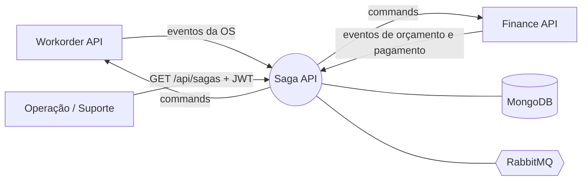
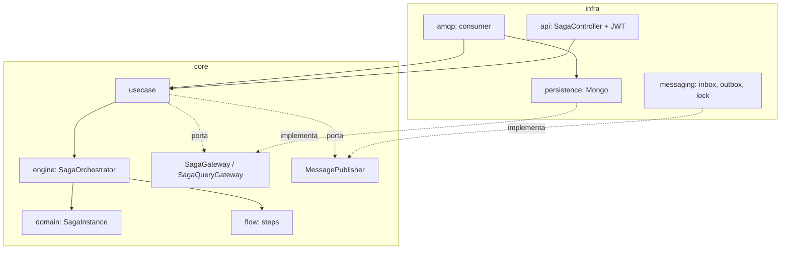
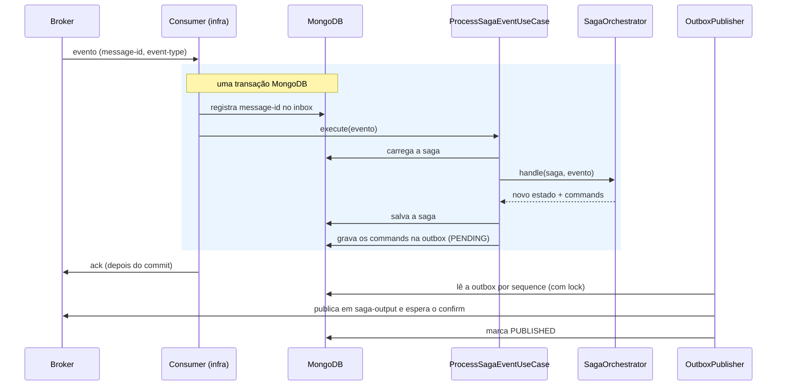
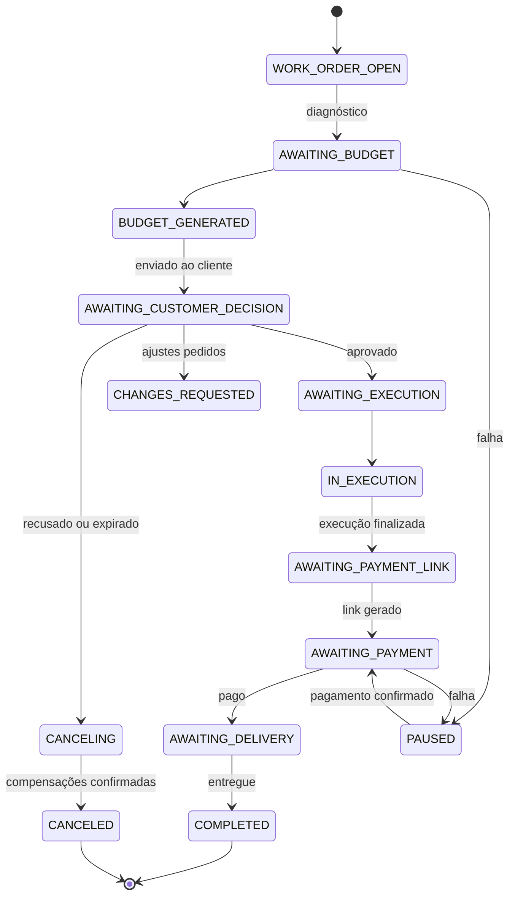

# Arquitetura da Saga API

> **Material de apoio.** Explicação técnica escrita durante o desenvolvimento; pode estar desatualizada em detalhes. A referência é o [README](../../README.md), que descreve o que foi entregue; as decisões estão nos [ADRs](../adr/) e [RFCs](../rfc/).
Documento de arquitetura do `mecanicadm-saga-api-v4`, organizado nas seções do modelo arc42. Ele **resume e aponta**: cada decisão
tem o seu ADR/RFC, e a tabela completa de transições fica em [saga-fluxo.md](saga-fluxo.md). A visão do sistema com os três
serviços está em [arquitetura-geral.md](../arquitetura-geral.md).

| | |
|---|---|
| **Serviço** | Saga API (orquestrador do fluxo da Ordem de Serviço) |
| **Status** | Vigente |
| **Atualizado em** | 12/11/2026 |

## 1. Objetivos e requisitos

| Objetivo | Como a arquitetura responde |
|---|---|
| Coordenar uma transação distribuída (OS, orçamento, pagamento) sem transação global | Saga **orquestrada**, uma instância por OS ([RFC 001](../rfc/001-escolha_do_padrao_saga_orquestrado.md)) |
| Desfazer o que já foi feito quando o fluxo falha ou é cancelado | Compensações por etapa, com confirmação e pausa ([ADR 002](../adr/002-compensacao_com_confirmacao_e_pausa.md)) |
| Nenhuma mensagem perdida nem processada duas vezes | Inbox + outbox transacionais ([ADR 003](../adr/003-outbox_inbox_e_politica_de_falhas.md)) |
| Cada serviço evolui sem conhecer os outros | Só mensagens; contratos do consumidor ([ADR 004](../adr/004-contratos_definidos_pelo_consumidor.md)) |
| Saber em que ponto cada OS está | API de consulta e histórico por saga ([ADR 006](../adr/006-api_de_consulta_com_jwt_compartilhado.md)) |

## 2. Restrições

- Java 21 e Spring Boot 3.4, o mesmo padrão dos outros serviços.
- **MongoDB como replica set**: a saga, o inbox e a outbox são gravados em uma transação multi-documento, que só existe em replica set ([RFC 002](../rfc/002-escolha_do_mongodb_como_banco_da_saga.md)).
- **RabbitMQ** como broker (hospedado pelo compose desta API no ambiente local; CloudAMQP em produção).
- A saga **não altera dados dos outros serviços**: só envia commands.
- A API HTTP é somente de consulta e usa o JWT emitido pela Workorder API.

## 3. Contexto

A saga só fala com o broker e com o seu banco. Os eventos que ela consome e os commands que emite estão em
[saga-fluxo.md](saga-fluxo.md); a topologia de filas, no [ADR 010](../adr/010-topologia_do_rabbitmq.md).

## 4. Estratégia da solução

| Tema | Decisão |
|---|---|
| Padrão de saga | Orquestrado, com uma saga por OS (`workOrderId`) |
| Estilo | Camadas `core` e `infra`, dependência em um só sentido ([ADR 007](../adr/007-camadas_e_regra_de_dependencia.md)) |
| Motor × fluxo | Motor genérico (`engine`) separado do fluxo de negócio (`flow`), um step por etapa ([ADR 001](../adr/001-orquestrador_orientado_a_eventos_por_etapas.md)) |
| Falha de negócio de um command | Evento de recusa, nunca exceção que vai para a DLQ ([ADR 005](../adr/005-eventos_de_recusa_de_command.md)) |
| Eventos fora de lugar | Ignora o atrasado, pausa o que está à frente ([ADR 008](../adr/008-eventos_inesperados_atrasados_e_duplicados.md)) |
| Dados da OS | A saga guarda o retrato e calcula o total ([ADR 009](../adr/009-retrato_da_os_e_total_calculado_pela_saga.md)) |
| Mensageria | Exchanges `headers` e uma DLQ por fila ([ADR 010](../adr/010-topologia_do_rabbitmq.md)) |

## 5. Visão de blocos

### 5.1 Camadas

### 5.2 Peças do `core/saga`

| Pacote | Conteúdo |
|---|---|
| `event`, `command` | As mensagens que entram (`SagaEvent`, interface selada) e saem (integration commands) |
| `domain` | `SagaInstance` (o agregado), `SagaState`, `SagaStep`, o histórico e o retrato da OS |
| `engine` | `SagaOrchestrator`, `SagaDefinition`, `TransitionRule`, `Guards`, `Compensation`, `CompensationPlanner` |
| `flow`, `flow/steps` | `SagaFlow` e, em `steps`, um step por assunto: `RegistrationStep`, `BudgetStep`, `CustomerDecisionStep`, `ExecutionStep`, `PaymentStep`, `DeliveryStep`, `CancellationStep`, `CommandRejectionStep`, `UnexpectedEventStep`; e `SagaFlow`, que os monta |
| `usecase` | `ProcessSagaEventUseCase`, `GetAllSagasUseCase`, `GetSagaByIdUseCase` |

O `SagaDefinition` **exige uma regra para cada evento** e falha na criação se faltar alguma: um evento novo sem regra não sobe.

## 6. Visão de execução

### 6.1 Do evento ao command

### 6.2 Se algo dá errado

| Situação | Resultado |
|---|---|
| Mensagem já processada (`message-id` repetido) | Duplicada: ignora e dá ack |
| Evento de uma OS sem saga | Inbox `REJECTED`, com ack; pode ser reprocessado quando a saga existir |
| Falha técnica (banco fora, bug, conflito de versão) | A transação é desfeita, `FAILED` no inbox, `nack` sem requeue e a mensagem vai para a DLQ |
| Command recusado pelo serviço de destino | Evento de recusa; a saga compensa e pede o cancelamento da OS ([ADR 005](../adr/005-eventos_de_recusa_de_command.md)) |
| Evento que não se aplica ao estado | Ignorado (e registrado) ou, se está à frente, a saga pausa ([ADR 008](../adr/008-eventos_inesperados_atrasados_e_duplicados.md)) |

## 7. Estados da saga

O diagrama mostra o caminho principal; a **tabela completa** (todos os eventos, guardas e commands) é a de
[saga-fluxo.md](saga-fluxo.md). Alterar a OS com orçamento ativo volta a saga a `WORK_ORDER_OPEN`, e o cancelamento vale de
qualquer etapa.

## 8. Dados

A coleção `saga_instances` guarda, por OS: o `state`, o motivo e a origem da pausa, o retrato da OS, o total do orçamento, as
compensações pendentes, o link de pagamento e o **histórico** (uma entrada por evento: evento, estado de origem e de destino,
commands emitidos, momento). As coleções `inbox`, `outbox` e `locks` sustentam a mensageria. O `@Version` do documento faz o
lock otimista. O formato completo está em [saga-fluxo.md](saga-fluxo.md#dados-guardados-mongodb).

## 9. Conceitos transversais

### 9.1 Garantias

| Garantia | Como é obtida |
|---|---|
| **Atomicidade** entre saga, inbox e outbox | Uma transação do MongoDB aberta no consumer e usada por tudo o que vem depois |
| **Idempotência** do consumo | O `message-id` no inbox, gravado dentro da transação |
| **Nenhum command se perde** | O command só existe se a transação deu certo; a outbox o guarda até o broker confirmar; o ack vem depois do commit |
| **Entrega pelo menos uma vez** | Se a saga cair entre o confirm do broker e o `markPublished`, o command é reenviado; quem recebe deduplica pelo `message-id` |
| **Ordem dos commands** | A outbox é lida por `sequence`, e só uma instância publica por vez (`DistributedLock`) |
| **Concorrência na mesma saga** | `@Version` (lock otimista); o conflito manda a mensagem para a DLQ |
| **Um consumer para as duas filas** | Eventos da Workorder e do Finance da mesma OS não rodam em paralelo |

### 9.2 Segurança

A API de consulta valida o JWT emitido pela Workorder (segredo `JWT_SECRET` compartilhado). Swagger, actuator e health são
públicos. A saga não recebe nada por HTTP que mude o fluxo ([ADR 006](../adr/006-api_de_consulta_com_jwt_compartilhado.md)).

### 9.3 Observabilidade

Logs estruturados por evento do fluxo (`SAGA_PAUSED`, `SAGA_COMPENSATED`, `SAGA_COMPENSATION_FAILED`...), descritos em
[saga-fluxo.md](saga-fluxo.md#logs-e-alertas), e o agente New Relic embarcado na imagem.

## 10. Configuração

| Variável | Padrão | Efeito |
|---|---|---|
| `MONGODB_URI` | `mongodb://localhost:27017/saga_db?directConnection=true` | Conexão com o MongoDB (replica set) |
| `RABBITMQ_HOST`, `_PORT`, `_USER`, `_PASSWORD`, `_VHOST` | `localhost`, `5672`, `guest`, `guest`, `/` | Conexão com o broker |
| `RABBITMQ_SSL_ENABLED` | `false` | TLS (`true` e porta `5671` no CloudAMQP) |
| `JWT_SECRET` | sem padrão | Segredo igual ao da Workorder API |
| `CONSUMER_PREFETCH` | `10` | Mensagens recebidas adiantadas |
| `OUTBOX_SCHEDULER_ENABLED` | `true` | Liga a publicação e a limpeza da outbox |
| `OUTBOX_PUBLISHER_INTERVAL_MS` | `1000` | Intervalo entre rodadas de publicação |
| `OUTBOX_BATCH_SIZE` | `50` | Mensagens por rodada |
| `OUTBOX_CONFIRM_TIMEOUT_MS` | `5000` | Espera pelo confirm do broker |
| `OUTBOX_RETENTION_DAYS`, `OUTBOX_CLEANUP_CRON` | `7`, `0 0 3 * * *` | Retenção e horário da limpeza |

## 11. Qualidade e testes

| Nível | O que cobre |
|---|---|
| Unitários (183) | Motor, steps, compensações, casos de uso e API, em Java puro, sem banco nem broker |
| BDD (10 cenários) | O fluxo completo e as compensações em Gherkin (português), pelo caso de uso real, com repositório em memória |
| Integração (39) | MongoDB (transações, consultas, lock), RabbitMQ e o ciclo completo evento → saga → outbox, com Testcontainers |
| Cobertura | 92,3% das linhas, 93,7% das instruções e 81,6% dos branches (JaCoCo) |

O `RabbitMQConfigTest` garante que todo evento tem binding. O `SagaDefinition` garante que todo evento tem regra.

## 12. Riscos e limitações

| Item | Situação |
|---|---|
| Pausa sem retomada automática | Pausas por recusa do cancelamento da OS e por evento inesperado exigem intervenção manual (README, "Retomando uma saga pausada") |
| Retomada de sagas pausadas por API | Não implementada: a API é somente de consulta |
| Retrato da OS defasado | Depende de a Workorder publicar `WorkOrderUpdatedEvent` a cada mudança de itens ([ADR 009](../adr/009-retrato_da_os_e_total_calculado_pela_saga.md)) |
| Mensagem sem binding | O broker a descarta em silêncio ([ADR 010](../adr/010-topologia_do_rabbitmq.md)) |
| Regra de dependência `core` → `infra` | Imposta só por revisão; não há teste de arquitetura ([ADR 007](../adr/007-camadas_e_regra_de_dependencia.md)) |
| Dados pessoais do cliente na saga | O retrato guarda nome, e-mail, documento e telefone; a API expõe só nome e placa |

## 13. Glossário

| Termo | Significado |
|---|---|
| **Saga** | Uma instância do fluxo, para uma OS (`workOrderId`) |
| **Evento** | Fato que um serviço publica sobre o que aconteceu no seu domínio |
| **Command** (*integration command*) | Pedido da saga a um serviço |
| **Etapa** (`SagaStep`) | Grupo de estados do fluxo: registro, orçamento, decisão do cliente, execução, pagamento, entrega |
| **Compensação** | Command que desfaz o efeito de uma etapa já concluída |
| **Pausa** | A saga para e guarda o estado de origem e o motivo, à espera de resolução |
| **Inbox / Outbox** | Tabelas que dão idempotência ao consumo e garantia de envio |
| **DLQ** | Fila de mensagens que falharam e esperam análise |

## 14. Registro de decisões

| # | Título |
|---|---|
| [RFC 001](../rfc/001-escolha_do_padrao_saga_orquestrado.md) | Escolha do padrão saga orquestrado |
| [RFC 002](../rfc/002-escolha_do_mongodb_como_banco_da_saga.md) | Escolha do MongoDB como banco da saga |
| [ADR 001](../adr/001-orquestrador_orientado_a_eventos_por_etapas.md) | Orquestrador orientado a eventos, por etapas |
| [ADR 002](../adr/002-compensacao_com_confirmacao_e_pausa.md) | Compensação com confirmação e pausa |
| [ADR 003](../adr/003-outbox_inbox_e_politica_de_falhas.md) | Outbox, inbox e política de falhas |
| [ADR 004](../adr/004-contratos_definidos_pelo_consumidor.md) | Contratos definidos pelo consumidor |
| [ADR 005](../adr/005-eventos_de_recusa_de_command.md) | Eventos de recusa de command |
| [ADR 006](../adr/006-api_de_consulta_com_jwt_compartilhado.md) | API de consulta com JWT compartilhado |
| [ADR 007](../adr/007-camadas_e_regra_de_dependencia.md) | Camadas e regra de dependência |
| [ADR 008](../adr/008-eventos_inesperados_atrasados_e_duplicados.md) | Eventos inesperados, atrasados e duplicados |
| [ADR 009](../adr/009-retrato_da_os_e_total_calculado_pela_saga.md) | Retrato da OS e total calculado pela saga |
| [ADR 010](../adr/010-topologia_do_rabbitmq.md) | Topologia do RabbitMQ |
